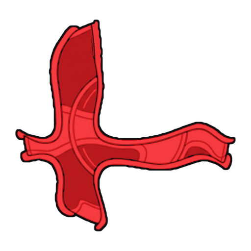
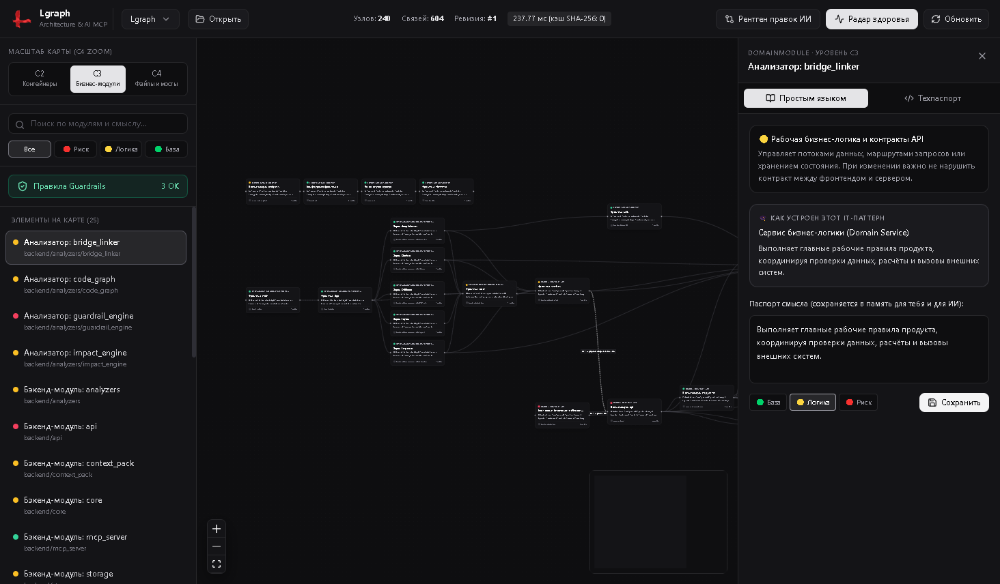

<div align="center">
  
  <h1>Lgraph v2.4</h1>
  <p><strong>Visual Architecture Map, Cross-Language Contract Linker & Zero-Bloat MCP Intelligence for AI Coding Agents</strong></p>
  <p><em>Визуальная карта архитектуры, сшиватель межъязыковых контрактов и автономный MCP-сервер сжатия контекста для нейросетей (Antigravity, Cursor, Claude Code)</em></p>
</div>

---



## Что такое Lgraph (и зачем он нужен)

**Lgraph** — локальная десктопная платформа и автономный `MCP`-сервер, решающий главную боль современной ИИ-разработки: *слепое чтение десятков файлов, обрывы контрактов между фронтендом и сервером и разрастание монолитов*.

1. **Для владельца продукта и инженера (Desktop UI на Electron + React Flow + ELK.js):**
   - Строит чистую слоистую карту архитектуры по уровням **`C2 Контейнеры → C3 Бизнес-модули → C4 Файлы и мосты`**.
   - Подсвечивает светофор рисков (`🔴 Критично / 🟡 Бизнес-логика / 🟢 База`), объясняет IT-паттерны простым языком в двуязычном **Паспорте узла** и показывает **«Рентген правок ИИ»** поверх `git diff`.
2. **Для AI-агентов (`Antigravity`, `Cursor`, `Claude Code`, `Windsurf`):**
   - Отдаёт сжатую архитектурную капсулу задачи (`Personalized PageRank` строго в рамках `token_budget`, экономя контекст в ~15–25 раз).
   - Двусторонне сшивает межъязыковые мосты (`TypeScript/React ↔ Electron IPC ↔ Python FastAPI` + общие схемы `Pydantic/SQLModel ↔ TS interface`).
   - Считает радиус зацепления правок (`signature_changes` vs `body_only_changes`) и проверяет 5 типов детерминированных машинных правил **`Guardrails`** с защитой секретов (`<REDACTED_SECRET>`) и изоляцией чужих комментариев (`<untrusted_code_doc>`).

---

## 🚀 Быстрая установка и запуск (Windows)

Требования: **Python 3.11+** и **Node.js 20+**.

```powershell
git clone https://github.com/Fulsepredict/lgraph.git
cd lgraph
SETUP.bat
```

Скрипт `SETUP.bat` автоматически:
1. Создаст `backend\venv` и установит зависимости Python (`tree-sitter`, `fastapi`, `mcp`, `pyyaml`).
2. Соберёт десктопный интерфейс `frontend/dist`.
3. Сгенерирует нативную многослойную иконку `logo.ico`, создаст ярлык **`Lgraph`** на Рабочем столе и зарегистрирует команду терминала **`lgraph`**.
4. Установит плагины **`lgraph-intelligence`** и **`independent-auditor`** в `%USERPROFILE%\.gemini\config\plugins\`.

### Как открывать проекты в 1 клик
- **С Рабочего стола:** дважды кликните по ярлыку **`Lgraph`** (или файлу `START_APP.bat`).
- **Из терминала любой папки:** введите `lgraph .` — окно сразу откроет карту текущей директории (если окно уже открыто, оно всплывёт наверх и переключится на новую папку без запуска дубля).

---

## 🤖 6 инструментов автономного MCP-сервера (`run_mcp_server.py`)

Сервер работает через `stdio` **без параметра `cwd` и без необходимости держать окно `Lgraph` открытым** — перед каждым ответом он за `~2–4 мс` сверяет метаданные файлов на диске (`is_project_disk_dirty`) и автоматически доиндексирует свежие правки:

| Инструмент | Назначение |
| :--- | :--- |
| `get_context_pack` | Сжатая капсула контекста задачи (`token_budget=2500`): правила + заметки `C3`/`C4` + мосты + ключевые функции по `PageRank` |
| `inspect_node_or_search` | Точный техпаспорт файла/функции с соседями и мостами либо мгновенный полнотекстовый поиск `SQLite FTS5` |
| `simulate_change_impact` | Двусторонний расчёт радиуса взрыва правок, разделение `signature_changes` / `body_only_changes` и проверка красного контура (`CRITICAL`) |
| `verify_architecture_rules` | Машинная проверка 5 предикатов `GuardrailEngine` с защитой от опечаток в фильтре путей (`NO FILES MATCHED FILTER`) |
| `save_architectural_note` | Сохранение человеческого или агентского паспорта смысла в долговременную память (`architectural_notes`) |
| `open_or_index_project` | Индексация папки проекта с кэшированием по `SHA-256` и полная сводка по узлам и связям |

### Подключение к Cursor / Claude Code (`mcp_config.json`)
```json
{
  "mcpServers": {
    "lgraph": {
      "command": "<PATH_TO_LGRAPH>\\backend\\venv\\Scripts\\python.exe",
      "args": [
        "<PATH_TO_LGRAPH>\\run_mcp_server.py"
      ],
      "env": {
        "PYTHONUTF8": "1",
        "PYTHONIOENCODING": "utf-8"
      }
    }
  }
}
```

📖 Подробные руководства:
- [3-слойная система качества ИИ (`GEMINI.md` + `Lgraph` + `Independent Auditor`)](docs/AI_INTEGRATION_GUIDE_RU.md)
- [Справочник всех 5 предикатов `lgraph.yaml` и `.lgraphignore`](.agent/skills/system-intelligence/references/lgraph_yaml_cookbook.md)

---

## 🧪 Автотесты, E2E и замер скорости (SLO)

Все тесты работают строго во временных директориях `tempfile.TemporaryDirectory()`, не затрагивая локальную базу `.lgraph_runtime`:

```powershell
# 1. Эталонные полигоны Golden Fixtures (Precision/Recall = 1.0) и самодиагностика Lgraph (все файлы <= 350 строк)
backend\venv\Scripts\python.exe backend\tests\test_golden_fixtures_and_core.py

# 2. Боевой экзамен ИИ-агента через реальный stdio подпроцесс MCP + конкурентность SQLite WAL (4 потока)
backend\venv\Scripts\python.exe backend\tests\test_ai_agent_mcp_battle.py

# 3. Замер скорости p50 / p95 и памяти Peak RAM
backend\venv\Scripts\python.exe backend\tests\benchmark_slo.py
```

---

## 📄 Лицензия

Проект распространяется под открытой лицензией **[MIT](LICENSE)**.
